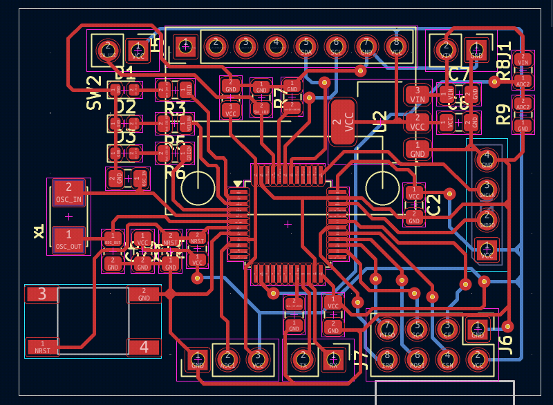
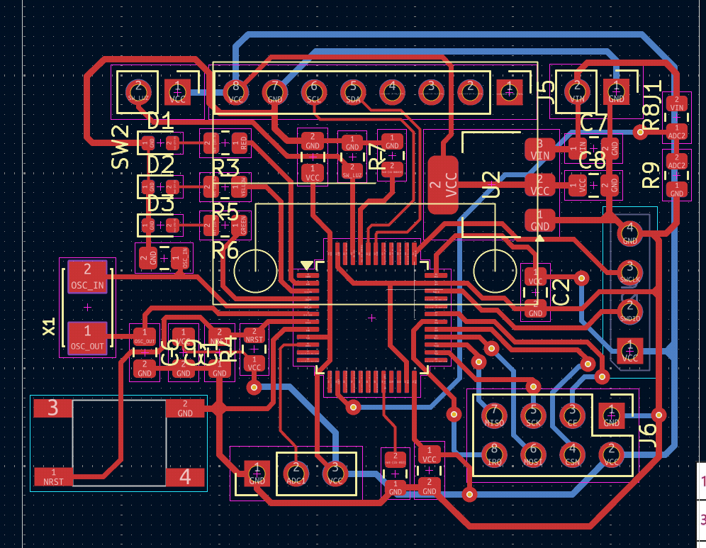
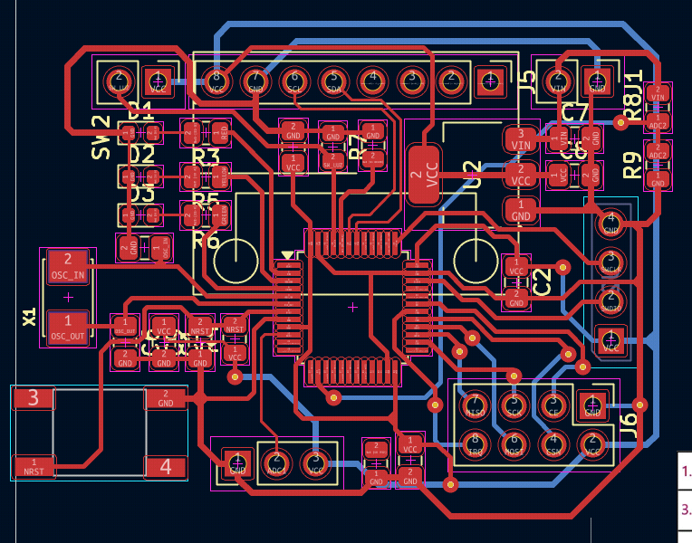
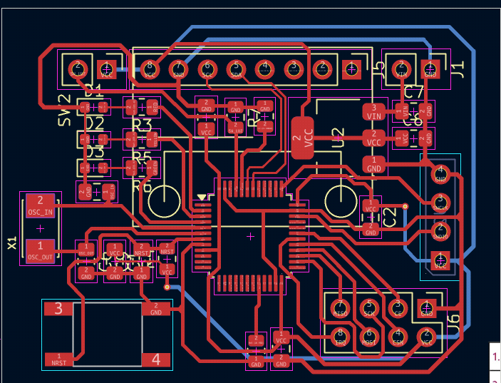
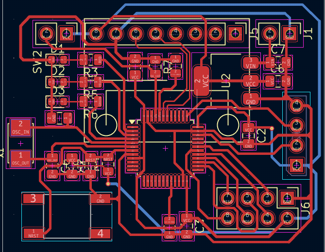
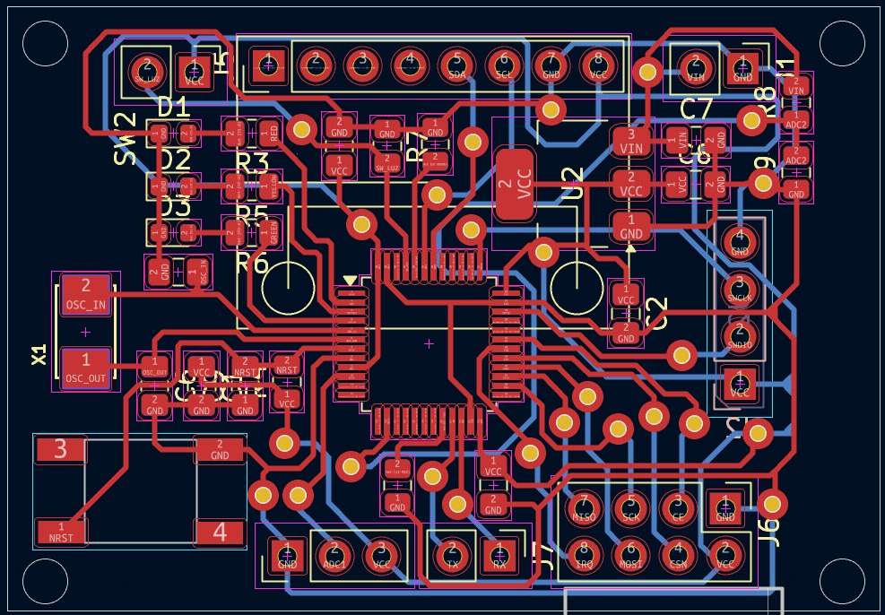
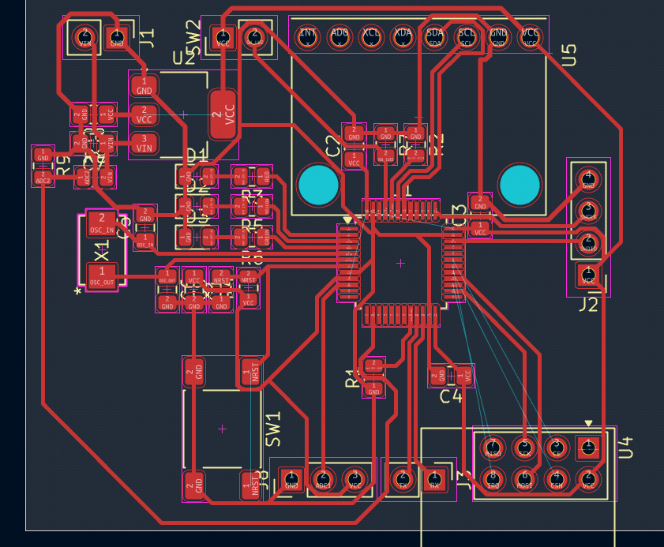
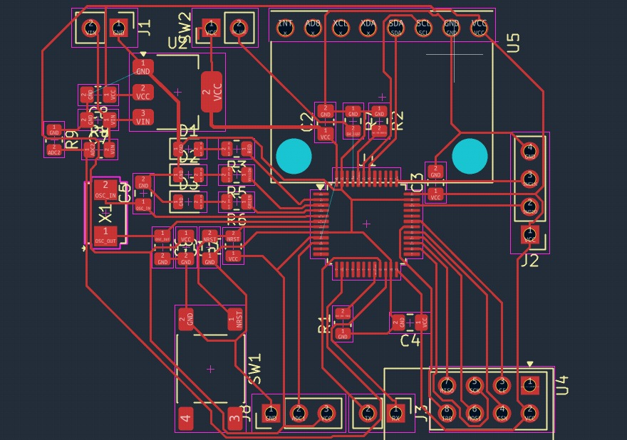

# Log File
## 6-29-26

## 6-29-26

## 6-29-26

## 6-24-26

## 6-23-26

# 8-27-26

# 10-10-26
- Changed footprints
- Attempt to do it in one layer
- Unconnected VCC and RF mod

# 10- 11-26
- Autoroute best try (Still not working)
- VCC, SW_Luz and GND not connectedº
